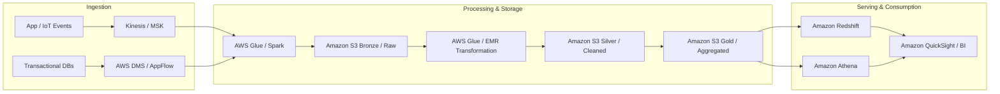

# Summary
Comprehensive knowledge base for **AWS Certified Data Engineer - Associate (DEA-C01)**. Covers the core pillars of cloud data engineering: high-throughput ingestion, distributed batch and stream processing, modern lakehouse/warehouse storage management, orchestration, and enterprise-grade data security and governance.

---

# Key Concepts & Exam Domains

## 1. Data Ingestion and Transformation (~28%)
- **Streaming Ingestion**:
  - **Amazon Kinesis Data Streams**: Real-time event streaming with sharding, retention up to 365 days, and enhanced fan-out.
  - **Amazon Kinesis Data Firehose**: Serverless delivery stream into S3, Redshift, OpenSearch, or Splunk; supports inline Lambda transformations and format conversions (e.g., JSON to Parquet).
  - **Amazon Managed Streaming for Apache Kafka (MSK)**: Fully managed Kafka clusters for high-volume decoupled streaming architectures.
- **Batch Ingestion & Migration**:
  - **AWS Glue (Crawlers, Data Catalog, ETL Jobs)**: Serverless Apache Spark ETL; schema discovery, job bookmarks for state tracking, DynamicFrames.
  - **AWS Database Migration Service (DMS)**: Heterogeneous and homogeneous DB replication with minimal downtime (Change Data Capture - CDC).
  - **AWS AppFlow**: Managed bidirectional integrations with SaaS platforms (Salesforce, Zendesk, ServiceNow) into S3/Redshift.
- **Distributed Compute & Processing**:
  - **Amazon EMR**: Scalable big data compute running Apache Spark, Hadoop, Presto, Trino, and Hive; supports Spot instances for batch cost reduction and EMR Serverless.
  - **AWS Lambda**: Event-driven micro-batch ingestion and file validation triggered by S3 uploads or Kinesis records.
- **Data Formats & Optimization**:
  - Columnar formats (**Apache Parquet**, **Apache ORC**) for analytical queries; row-based (**Apache Avro**) for streaming/schema evolution.
  - Partitioning strategy (e.g., `year=YYYY/month=MM/day=DD`) and file sizing (aiming for 128MB–512MB to avoid the small-file problem).

## 2. Data Store Management (~26%)
- **Data Lake (Amazon S3 & AWS Lake Formation)**:
  - **Amazon S3**: Central object store with tiered lifecycle policies (Standard, Infrequent Access, Glacier, Flexible/Deep Archive), Object Lock (WORM), versioning, and cross-region replication.
  - **Modern Table Formats**: Apache Iceberg, Delta Lake, and Apache Hudi support on top of S3.
  - **AWS Lake Formation**: Centralized data governance, fine-grained access control (table, column, row, cell-level security), and cross-account data sharing via AWS RAM.
- **Data Warehousing (Amazon Redshift)**:
  - Cluster architecture: Leader node and Compute nodes with columnar storage and zone maps.
  - **Distribution Styles**: `KEY` (colocate joined tables), `ALL` (replicate small dimension tables), `EVEN` (round-robin for staging), `AUTO`.
  - **Sort Keys**: `COMPOUND` (hierarchical filtering) vs `INTERLEAVED` (equal weight across columns).
  - **Redshift Serverless & Redshift Spectrum**: Direct querying of open file formats sitting in S3 without loading them into local cluster disks.
  - **Materialized Views**: Precomputing complex aggregations for fast BI dashboard reads.
- **NoSQL & Specialized Stores**:
  - **Amazon DynamoDB**: Key-value & document store; Partition Key + Sort Key design, Global Secondary Indexes (GSI), Local Secondary Indexes (LSI), and DynamoDB Streams for change capture.
  - **Amazon OpenSearch Service**: Log analytics, full-text search, and time-series search indexing.
  - **Amazon Timestream & DocumentDB**: Purpose-built time-series and MongoDB-compatible engines.

## 3. Data Operations, Orchestration & Support (~22%)
- **Pipeline Orchestration**:
  - **AWS Step Functions**: Serverless visual workflow orchestrator for deterministic ETL workflows, error handling, retries, and human-in-the-loop approvals.
  - **Amazon MWAA (Managed Workflows for Apache Airflow)**: Python-native DAG orchestrator for complex dependency chains and enterprise data pipelines.
  - **Amazon EventBridge**: Event-driven triggering based on cloud system events or scheduled cron intervals.
- **Data Quality & Schema Evolution**:
  - **AWS Glue Data Quality**: Rule-based data validation (freshness, completeness, uniqueness) preventing corrupt data propagation.
  - Schema registries for Avro/Protobuf schema compatibility validation.
- **Observability & Debugging**:
  - **Amazon CloudWatch**: Custom metrics, alarm notifications, logs aggregation for Glue jobs, Lambda, and EMR tasks.
  - **AWS CloudTrail**: Auditing API calls across all AWS data infrastructure.

## 4. Data Security and Governance (~24%)
- **Identity & Access Management (IAM)**:
  - Least privilege principle, resource-based policies, IAM roles for service execution (e.g., Glue/Lambda execution roles).
  - IAM session policies and temporary credentials with AWS STS.
- **Encryption**:
  - **At Rest**: AWS KMS with Customer Managed Keys (CMK) or AWS-managed keys; SSE-S3, SSE-KMS, SSE-C.
  - **In Transit**: TLS 1.2/1.3 enforcement across API endpoints and internal cluster communication.
- **Data Privacy & Governance**:
  - **Amazon Macie**: Automated PII discovery and data privacy monitoring in S3 buckets.
  - Masking, tokenization, and anonymization pipelines before publishing data to consumer tiers.

---

# Architectural Patterns

---

# Practical Applications
- **Enterprise Lakehouse Design**: Ingest raw OLTP database CDC streams into S3 Bronze layers, cleanse with Glue PySpark, and curate into Gold tables queried via Athena or loaded into Redshift.
- **Real-Time Analytics Pipeline**: Stream clickstream logs through Kinesis Data Firehose with automated format conversion into Parquet and query immediately using serverless analytics.
- **Automated Cost Optimization**: Implement S3 Lifecycle transitions to Glacier Instant Retrieval and configure Redshift auto-pause and auto-scaling to control cloud expenditures.

---

# Related Notes
- [[Cloud Computing]]
- [[Backend/PostgreSQL|PostgreSQL]]
- [[Software Engineering/Databases|Databases]]
- [[Software Engineering/Scalability|Scalability]]
- [[03 Career/Resume|Resume]]
- [[00 Dashboard/Main Dashboard|Main Dashboard]]

---

# References
- [AWS Certified Data Engineer - Associate (DEA-C01) Exam Guide](https://aws.amazon.com/certification/certified-data-engineer-associate/)
- [AWS Well-Architected Framework: Data Analytics Lens](https://docs.aws.amazon.com/wellarchitected/latest/analytics-lens/welcome.html)
