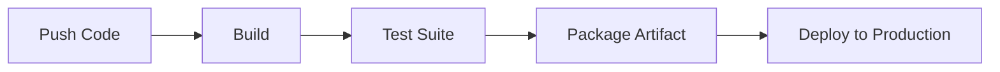

# Summary
Continuous Integration, Delivery, and Deployment automate validation, testing, packaging, and release processes throughout the Software Development Lifecycle (SDLC), ensuring high software reliability and rapid release cadence.

# Key Concepts

## CI vs. CDel vs. CDep
- **Continuous Integration (CI)**: Every code change pushed to a shared repository is automatically merged, built, and tested against automated suites. Catches integration bugs immediately.
- **Continuous Delivery (CDel)**: Extends CI by ensuring every build passing automated verification is automatically packaged and held ready to release to production at any moment via manual or triggered promotion.
- **Continuous Deployment (CDep)**: Goes a step further: every passing build automatically deploys straight to production end users with zero manual intervention.

## The Standard CI/CD Pipeline

## GitHub Actions Architecture
CI/CD workflow engine integrated directly into GitHub repositories:
- **Event**: The webhook trigger initiating pipeline execution (e.g., `push`, `pull_request`, `schedule`, `workflow_dispatch`).
- **Workflow**: Top-level automated procedure defined in a YAML configuration file under `.github/workflows/`.
- **Job**: A coordinated sequence of steps executing on a fresh virtual machine or container (`runner`). Jobs run in parallel by default unless configured with dependencies (`needs`).
- **Step / Action**: Individual tasks within a job; can be a shell command (`run`) or a modular, reusable routine from the GitHub Actions Marketplace (`uses`).

## Placement in the SDLC
Automated verification sits between code construction and deployment:
$$\text{Plan} \longrightarrow \text{Code} \longrightarrow \text{Build} \longrightarrow \mathbf{Test\ (Automated\ via\ GH\ Actions)} \longrightarrow \text{Release} \longrightarrow \text{Deploy} \longrightarrow \text{Monitor}$$

# Practical Applications
- Setting up pull-request validation workflows running linting and [[Testing|Playwright / Jest tests]] before merging into `main`.
- Automating staging and production deployments in [[Portfolio Website]], [[OnboardIQ]], and [[POS System]].

# Related Notes
- [[Software Engineering MOC]]
- [[DevOps]]
- [[Testing]]
- [[Software Development Lifecycle]]
- [[DevOps and AI]]

# References
- CI/CD with github action C3 (Keep Note)
- Clean Code by Robert C. Martin
- Designing Data-Intensive Applications by Martin Kleppmann
