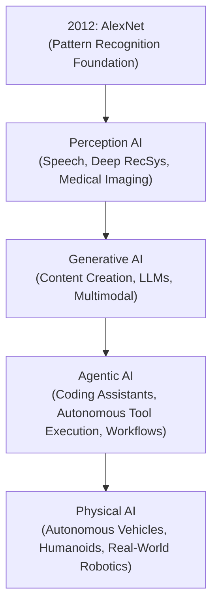
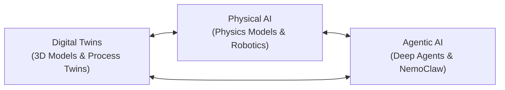

# Summary
Physical AI represents the next trillion-dollar frontier where artificial intelligence moves beyond digital screens into the physical world. Grounded in robotics mathematics, high-fidelity physics simulations (NVIDIA Omniverse), and synthetic data, real-world AI converges across Digital Twins, Physical AI, and Agentic AI.

# Key Concepts

## The Evolution of AI
Artificial intelligence has progressed through distinct transformative paradigms:

## Robotics Math: When Theory Meets Reality
Physical AI systems must ground decision-making in classical physical mechanics:
- **Position**: $x(t)$
- **Velocity**: $v(t) = \frac{dx}{dt} = \dot{x}(t)$
- **Acceleration**: $a(t) = \frac{dv}{dt} = \ddot{x}(t) = \frac{F_{\text{net}}(t)}{m}$

Bridging mathematical formulations to real-world deployment requires modeling continuous physical forces, mass distribution, actuator limits, and friction under sensor noise and hardware latency.

## NVIDIA Omniverse: Brain and Simulation Stage
- **Physics-Based Virtual Worlds**: High-fidelity simulation platform enabling robots and autonomous agents to train within accurate, real-world physics environments with real data.
- **Risk-Free Validation**: Validates complex robotic interactions and manufacturing lines without hardware wear, physical hazards, or downtime costs.
- **Sim-to-Real Transfer**: Uses **Synthetic Data** with **Domain Randomization** and adaptation techniques so models trained in simulation transfer seamlessly to physical hardware.

## The Convergence: Digital Twins, Physical AI, and Agentic AI
Modern real-world intelligent systems emerge from the intersection of three foundational pillars:

1. **Digital Twins**:
   - **3D Models**: Virtual representations of warehouse production lines, material handling equipment (MHE), and manufactured products.
   - **Process Twins**: Real-time simulation and optimization of warehouse operations, factory throughput, and supply chain bottlenecks.
2. **Physical AI**:
   - Physics-based models (mechatronics, kinematics, fluid dynamics).
   - Machine perception and vision AI for spatial scene understanding.
   - Humanoid robot training and autonomous machine navigation.
   - Reinforcement Learning (RL) applied during post-training.
3. **Agentic AI & Engineering**:
   - **Deep Agents & NemoClaw**: Goal-directed reasoning engines capable of autonomous planning, policy compliance, and anomaly response.
   - **Agentic Operations**: Enterprise and industrial agents actively executing tasks (e.g., dynamic supply chain rescheduling, equipment diagnostics).

## Engineering Mindset
> *"An engineer needs business acumen to be a better engineer at any company."*
Understanding product viability, operational ROI, unit economics, and client pain points is what turns technical capabilities into transformative real-world solutions.

# Real-World Architecture

# Practical Applications
- Warehouse automation and dynamic routing of automated guided vehicles (AGVs) using NVIDIA Omniverse simulation.
- Integrating agentic decision layers with physical telemetry in industrial supply chains (see [[AI in Supply Chain]]).
- Simulating robotic control policies via synthetic data before compiling to edge microcontrollers.

# Related Notes
- [[AI Trends 2026]]
- [[AI Agents]]
- [[Agentic Workflows]]
- [[AI MOC]]
- [[AI in Supply Chain]]

# References
- AI Week LATAM 2026 Nvidia Tech (Keep Note)
- SoftServe / NVIDIA Keynote: *IA en el Mundo Real: Convergencia de Gemelos Digitales, IA Física y la IA Agéntica*
- NVIDIA Omniverse Documentation
