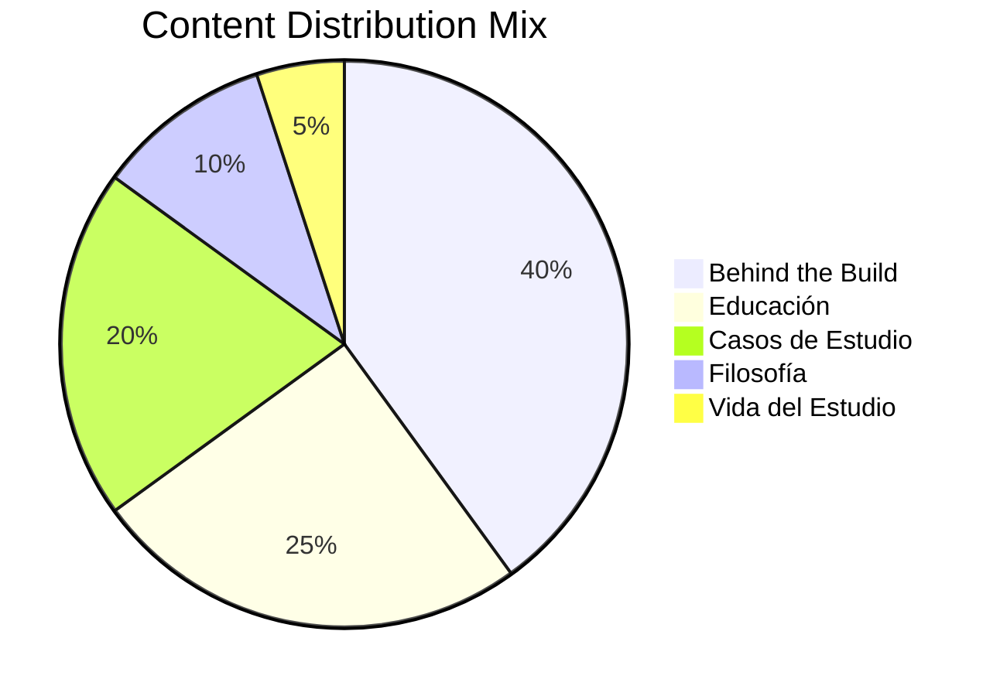

# Summary
A structured content marketing and organic distribution framework for digital design and web engineering studios (specifically tailored for **Pixel by Bovio**), built on 5 strategic content pillars, proven viral formats, episodic storytelling, and a sustainable publication cadence.

# Key Concepts

## The 5 Content Pillars

### 1. Behind the Build (40%)
Documenting the practical engineering and design craftsmanship behind projects.
- **Goal**: Proves deep domain authority through tangible proof of work rather than claiming to be an "expert".
- **Examples**:
  - *"Cómo diseñé este hero section."*
  - *"Antes vs. después de una landing page."*
  - *"Por qué eliminé 200 líneas de código para mejorar el rendimiento."*
  - *"Cómo organizo un proyecto escalable con Next.js y Tailwind."*
  - *"Así planeo la arquitectura de un software antes de escribir una sola línea de código."*

### 2. Educación (25%)
Demystifying technical and design principles for business owners and non-technical decision makers.
- **Goal**: Attract clients by solving baseline doubts and communicating value in business terms.
- **Examples**:
  - *"¿Landing page o sitio web completo? Cuál necesita tu negocio."*
  - *"Tres errores comunes que hacen que una web no convierta visitantes en clientes."*
  - *"Qué factores técnicos hacen que un sitio web cargue lento."*
  - *"Qué significa realmente el SEO y cómo impacta tus ventas."*
  - *"Por qué tu negocio necesita una presencia web sólida aunque vendas por WhatsApp."*

### 3. Casos de Estudio (20%)
Structured breakdowns of solutions delivered for clients or internal showcase projects.
- **Universal Framework**:
  $$\text{Problema} \longrightarrow \text{Proceso} \longrightarrow \text{Resultado} \longrightarrow \text{Aprendizajes}$$
- **Example**:
  - *"Construí una landing page de alto rendimiento y reduje el tiempo de carga de 3.8s a 0.7s, duplicando la retención de usuarios."*

### 4. Filosofía (10%)
Establishing strong, opinionated brand identity and design standards.
- **Goal**: Sets Pixel by Bovio apart from commodity freelance developers and agencies.
- **Maniestos & Principles**:
  - *"Menos animaciones distractoras, más claridad de mensaje."*
  - *"Una buena web no necesita gritar para vender."*
  - *"Cada píxel debe tener un propósito funcional."*
  - *"El diseño no es mera decoración; es comunicación estratégica."*

### 5. Vida del Estudio (5%)
Occasional glimpses into the personal studio workspace and journey.
- **Goal**: Humanizes the brand while maintaining strict professional focus (avoiding turning the channel into a personal vlog).
- **Themes**: Workspace setup, acquiring a new domain, iterative logo sketches, influential design books, studio milestones.

---

## High-Performing Content Formats

### 1. Carrusel (Educational / Authority)
- **Slide 1 (Hook)**: *"5 errores que hacen que tu página web parezca poco profesional y pierda clientes."*
- **Slides 2–6**: Actionable, concise breakdowns of each error with visual contrast.
- **Final Slide (CTA)**: Branding and call-to-action for **Pixel by Bovio**.

### 2. Micro Reel (20–40 seconds)
Aesthetic, fast-paced build progression with lo-fi/ambient audio and captions:
$$\text{Figma Design} \longrightarrow \text{VS Code Implementation} \longrightarrow \text{Micro-animations} \longrightarrow \text{Final Deployed Result}$$

### 3. Before / After Breakdown
Side-by-side visual comparison explaining 3 specific design or performance decisions that transformed a low-converting layout into a clean, modern interface.

---

## Episodic Narrative: *"Building Pixel by Bovio"*
People connect with ongoing narrative arcs more than disjointed single posts. 
- **Episode 01**: Designing our identity and studio brand.
- **Episode 02**: Building our internal design system and UI components.
- **Episode 03**: Architecting and developing our flagship landing page.
- **Episode 04**: Crafting micro-animations that feel premium and tactile.
- **Episode 05**: Our logo evolution and typography rationale.

## Sustainable Cadence
Consistency outpaces burnout. A realistic, high-leverage weekly schedule:
- **2 Carruseles** per week (Educational + Behind the Build).
- **1 Reel** per week (Visual build progression / Before & After).
- **Daily / Periodic Stories** documenting incremental studio milestones.

# Practical Applications
- Implementing this organic content strategy to build inbound client acquisition for **Pixel by Bovio**.
- Showcasing UI/UX engineering, Next.js optimization, and design decisions from projects like [[Portfolio Website]] and [[OnboardIQ]].

# Related Notes
- [[Marketing]]
- [[02 Knowledge/SaaS MOC|SaaS MOC]]
- [[Customer Discovery]]
- [[Portfolio Website/Branding|Portfolio Branding]]
- [[Portfolio Website/SEO Strategy|SEO Strategy]]

# References
- Los 5 pilares de contenido (Keep Note)
- Pixel by Bovio Brand & Studio Strategy
