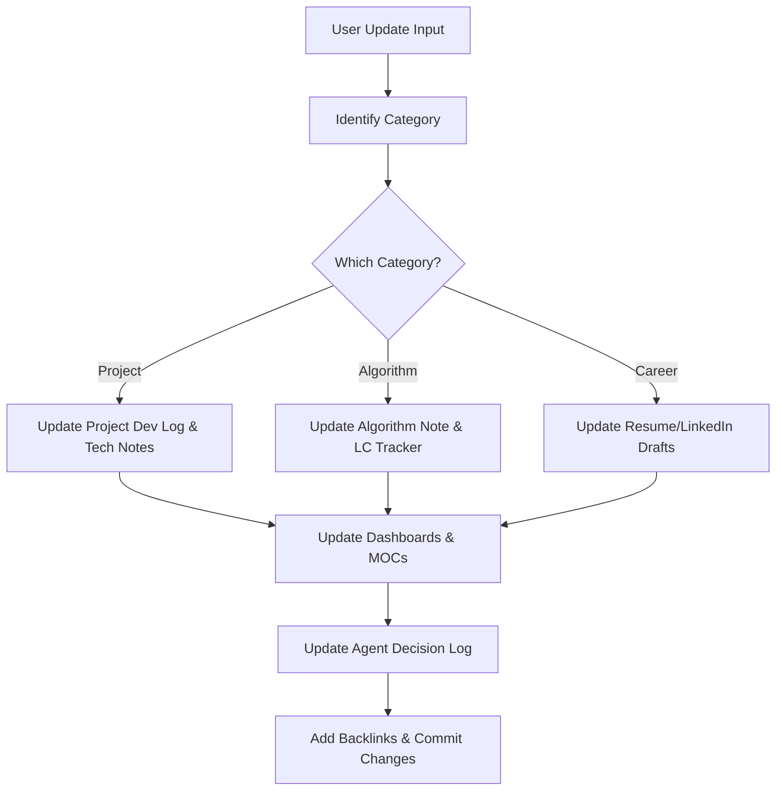

# ⚡ Auto-Update Workflow System
*Systematic updating rules for AI systems when processing new events.*

When a user provides updates (e.g., "I finished the inventory sync module for the POS system"), the AI agent must trigger the following workflow:

## Step-by-Step Execution Plan
1. **Locate Target Files**: Locate related documents in `01 Projects/`, `02 Knowledge/`, or `03 Career/`.
2. **Update Content**: Append progress details. Maintain the YAML frontmatter's `updated` attribute.
3. **Synchronize Indexes**:
   - Update the respective Dashboard.
   - Insert backlinks in related notes.
4. **Log Decisions**: Add entries to [[10 Agent Memory/Decision Log|Decision Log]] if an architectural change was implemented.
